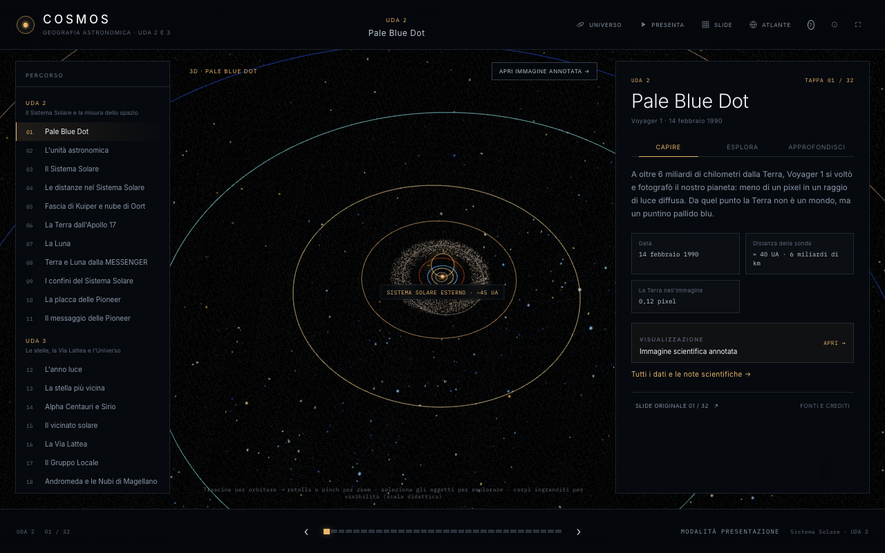
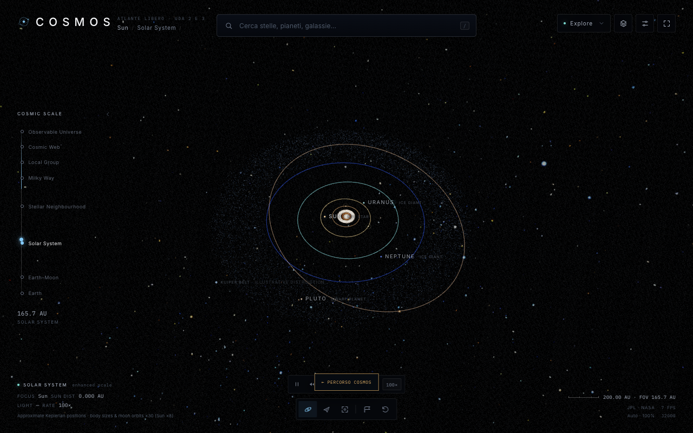

# COSMOS
### Atlante interattivo di Geografia astronomica · UDA 2 e UDA 3

> **La presentazione diventa un atlante navigabile.**
> Trentadue tappe tra slide originali, note del relatore e destinazioni 3D: dal Pale Blue Dot all'orizzonte cosmico.

COSMOS è la ricostruzione interattiva della presentazione del docente **«Geografia astronomica UDA 2 e 3»**. Non è un simulatore generico dell'Universo e non è una presentazione di screenshot: ogni slide è diventata una scena con un contenuto scientifico proprio, collegata all'originale e alle note del relatore.

**Live:** https://cosmos-atlante.pages.dev/  
**Locale:** `http://127.0.0.1:5173/`



---

## L'esperienza

- **Partenza cinematografica** con la Pale Blue Dot e il comando **«Inizia l'esplorazione»**.
- **L'universo al centro**: il 3D resta la superficie principale per tutte le 32 tappe; il pannello di spiegazione è a fianco, non davanti.
- **32 tappe** nella sequenza esatta della presentazione, divise in tre sezioni editoriali: UDA 2, UDA 3, Approfondimento. Si parte dalla Pale Blue Dot e si continua fino al tempo cosmico.
- **Strumenti 2D opzionali**: immagini annotate, confronti in scala, viaggi della luce, confini, timeline e gallerie si aprono in un cassetto compatto, senza nascondere il cielo.
- **Tre livelli di lettura** per ogni tappa: **Capire subito**, **Esplora**, **Approfondisci**.
- **Slide originale sempre raggiungibile**: dal pannello, dalla barra superiore o con il tasto `S`, con zoom, pan, hotspot e crediti.
- **Note del relatore**: 21 slide avevano note; sono state conservate integralmente e sono leggibili nella scheda *Approfondisci*.
- **Interrogazione**: 12 domande con risposta motivata e rimando alla slide.
- **Presentazione**: il 3D a schermo intero con il pannello di spiegazione a fianco; comandi precedente/successivo, tappe, slide originale; `Esc` per uscire.
- **Atlante libero (prima versione)**: un pulsante *Universo* apre l'atlante EON completo — ricerca di pianeti, stelle, galassie ed esopianeti, scala cosmica, schede oggetto, tour e zoom libero. Il pulsante *Percorso COSMOS* riporta alla presentazione.

### Le 32 tappe: universo 3D e strumenti opzionali

Ogni tappa accende una destinazione nell'atlante 3D, sempre visibile al centro. Le slide e gli strumenti 2D non sostituiscono mai l'universo: si aprono come **approfondimento laterale** quando servono. La scena principale e lo strumento sono entrambi verificati nella mappa di copertura.

| # | Tappa | Universo 3D | Strumento opzionale |
|---|---|---|---|
| 01 | Pale Blue Dot | Sistema Solare esterno · ~45 UA | Immagine annotata |
| 02 | L'unità astronomica | Sole–Terra · 1 UA | Viaggio della luce |
| 03 | Il Sistema Solare | Sistema Solare · vista sinottica | — (atlante 3D diretto) |
| 04 | Le distanze nel Sistema Solare | Sistema Solare · distanze orbitali | — (atlante 3D diretto) |
| 05 | Fascia di Kuiper e nube di Oort | Sistema Solare esterno | Scala dei confini |
| 06 | La Terra dall'Apollo 17 | Terra | Immagine annotata |
| 07 | La Luna | Luna | Linea del tempo |
| 08 | Terra e Luna dalla MESSENGER | Terra–Luna | Viaggio della luce |
| 09 | I confini del Sistema Solare | Sistema Solare esterno | Scala dei confini |
| 10 | La placca delle Pioneer | Sistema Solare esterno | Immagine annotata |
| 11 | Il messaggio delle Pioneer | Sistema Solare esterno | Immagine annotata |
| 12 | L'anno luce | Stelle vicine | Viaggio della luce |
| 13 | La stella più vicina | Proxima Centauri | — (atlante 3D diretto) |
| 14 | Alpha Centauri e Sirio | Vicinato solare | — (atlante 3D diretto) |
| 15 | Il vicinato solare | Vicinato solare · 100 al | — (atlante 3D diretto) |
| 16 | La Via Lattea | Via Lattea | — (atlante 3D diretto) |
| 17 | Il Gruppo Locale | Gruppo Locale | — (atlante 3D diretto) |
| 18 | Andromeda e le Nubi di Magellano | Andromeda e Nubi di Magellano | Galleria |
| 19 | Il Superammasso della Vergine | Superammasso della Vergine | — (atlante 3D diretto) |
| 20 | L'orizzonte cosmico | Universo osservabile | — (atlante 3D diretto) |
| 21 | La scala dell'Universo | Oltre l’orizzonte | — (atlante 3D diretto) |
| 22 | I Pilastri della Creazione | Nebulosa Aquila | Immagine annotata |
| 23 | Il Sole | Sole | — (atlante 3D diretto) |
| 24 | Il Sole e i pianeti | Sole e pianeti | Confronto in scala |
| 25 | Sirio, il Sole e la Terra | Sirio, Sole, Terra | Confronto in scala |
| 26 | I pianeti a confronto | Pianeti a confronto | Confronto in scala |
| 27 | Le stelle a confronto | Stelle a confronto | Confronto in scala |
| 28 | VY Canis Majoris | VY Canis Majoris | Confronto in scala |
| 29 | VY Canis Majoris, vista da Hubble | VY Canis Majoris · Hubble | Immagine annotata |
| 30 | La luce attorno a VY Canis Majoris | VY Canis Majoris · luce | Confronto in scala |
| 31 | UY Scuti | UY Scuti | Immagine annotata |
| 32 | Il calendario cosmico | Universo · tempo cosmico | Linea del tempo |

La mappa completa e verificabile è in **[`src/content/presentation-map.json`](src/content/presentation-map.json)**: per ogni slide riporta testo, note, oggetti astronomici, valori numerici, obiettivi didattici, immagini, **scena 3D primaria**, strumento opzionale, stato di verifica scientifica, fonti e stato di completamento.

**Copertura:** 32/32 slide · 32/32 destinazioni 3D · 21/21 note del relatore · 32/32 strumenti interattivi opzionali · 12 categorie · 12 domande.



---

## Le correzioni scientifiche

La presentazione è la fonte didattica, ma alcuni dati sono stati precisati. Le correzioni sono sempre visibili nella scheda **Approfondisci** della tappa interessata, non nascoste.

| Slide | Affermazione / punto | Nota scientifica aggiornata |
|---|---|---|
| 1 | Voyager 1 e Pale Blue Dot | Fotografia del 14 febbraio 1990; Voyager 1 ha attraversato l'eliopausa nel 2012. |
| 3 | I pianeti | Plutone è un pianeta nano dal 2006; la slide lo include tra i corpi del Sistema Solare. |
| 4 | Distanze in UA | Valori medi e arrotondati; le distanze dei veicoli sono datate. |
| 5, 9 | Nube di Oort | È un modello teorico, non una struttura osservata. L'eliopausa è una regione di transizione. |
| 7 | Apollo 11 | Allunaggio: 20 luglio 1969, 20:17 UTC. Primo passo: 21 luglio 1969, 02:56 UTC. La slide contiene solo l'immagine della Luna; la timeline è un approfondimento verificato. |
| 10–11 | Placca | È la **placca delle Pioneer**, non il disco d'oro delle Voyager. |
| 13 | 3 al | Proxima Centauri è a **4,24 al**; 3 al è un ordine di grandezza. |
| 18 | Andromeda 2,2 Mly | Le misure moderne danno **~2,54 Mly**. |
| 19 | Vergine 200 Mly, 2.500 galassie | Le stime moderne del Superammasso sono **~110 Mly**. La mappa SDSS è un campione parziale, non una fotografia completa. |
| 20 | Orizzonte cosmico | Raggio comovente **~46,5 miliardi di al**; non è un muro fisico. |
| 21 | Oltre l'orizzonte | L'estensione totale dell'Universo non è misurata; resta sconosciuta. |
| 22 | Pilastri e formazione del Sole | Il Sole **non si è formato** nella Nebulosa Aquila: le Pillars sono un esempio di formazione stellare. |
| 23 | Massa del Sole | La nota «2 miliardi di miliardi di tonnellate» è errata di un fattore 10⁹: la massa solare è **~2 × 10²⁷ t**. |
| 28 | VY Canis Majoris | Raggio **~1.420 R☉**, distanza **~3.820 al** (stime con incertezza). |
| 30 | Luce attorno a VY CMa | Con 1.420 R☉ il tempo calcolato è **~5,8 h**; la slide indica ~8 h, compatibile con stime storiche di raggio maggiori. Il valore mostrato è calcolato dinamicamente. |
| 31 | UY Scuti | La presentazione (2018) indica 1.708 R☉ e 9.460 al; stime moderne danno **~909 R☉** e **~5.900 al**. Stephenson 2-18 è spesso indicata come più grande. Il «primato» è storico e incerto. |
| 32 | Calendario cosmico | 300.000 anni ≈ **11,4 minuti** di calendario cosmico ≈ **0,022 mm** su un righello di 1 m. L'analogia del «centesimo di millimetro» è approssimata. |

---

## Dati e fonti

**Didattica**
- Presentazione del docente *Geografia astronomica UDA 2 e 3* (file originale in `source/`), slide originali e note del relatore.

**Immagini**
- Slide originali della presentazione.
- NASA / JPL-Caltech (Pale Blue Dot, Apollo, Voyager, Pioneer).
- NASA / ESA / Hubble Heritage Team (STScI/AURA), Nebulosa Aquila.
- NASA / ESA / Hubble, VY Canis Majoris e UY Scuti.
- Le immagini sono usate a scopo didattico; i crediti sono indicati nel visualizzatore.

**Dati astronomici**
- NASA/JPL Solar System Dynamics — elementi kepleriani approssimati (1800–2050).
- IAU — definizioni, pianeti nani, unità.
- HYG Database v4.1 (Astronomy Nexus, CC BY-SA 4.0) — stelle vicine.
- NASA Exoplanet Archive (`pscomppars`) — esopianeti.
- SDSS DR18 — galassie e quasar del campione a grande scala.
- NASA/IPAC NED — galassie e ammassi.
- Gaia DR3 / letteratura recente — stime di raggio e distanza per le stelle giganti.

L'app non effettua richieste di rete a runtime: catalogo, immagini e slide sono serviti localmente.

---

## Avvio

Requisiti: Node.js 20+ e un browser WebGL 2.

```bash
cd eon
npm install
npm start
# http://127.0.0.1:5173/
```

In alternativa, qualsiasi server statico:

```bash
python3 -m http.server 5173
```

Aprire `http://127.0.0.1:5173/` e premere **Inizia l'esplorazione**.

### Comandi

```bash
npm test          # test unitari: astronomia + copertura COSMOS
npm run test:e2e  # test browser Playwright (richiede il server locale)
npm run map       # rigenera src/content/presentation-map.json
npm run deploy    # build dist + deploy Cloudflare Pages
```

Il test E2E usa Chrome locale e SwiftShader; si può sovrascrivere con `CHROME_PATH` e `COSMOS_URL`.

---

## Struttura

```
index.html                         shell della pagina
src/cosmos/CosmosApp.js            controller COSMOS: landing, tappe, pannello, modal, quiz, presentazione
src/cosmos/stages.js               visualizzatori: immagine, scala, distanza, confini, timeline, galleria
src/cosmos/stage-config.js         configurazione delle 32 scene, categorie atlante, quiz
src/cosmos/cosmos.css              sistema visivo COSMOS
src/data/presentation.js           testi e note estratti dal PPTX
src/data/lesson.js                 le 32 tappe, fatti, scene, note scientifiche
src/content/presentation-map.json  mappa di copertura e tracciabilità
assets/presentation/slides/        32 slide originali renderizzate
assets/cosmos/images/              immagini scientifiche annotabili
src/scenes/                        motore 3D EON (Earth, Solar, Deep) e atlante libero
src/ui/, index.html               HUD EON della prima versione, riattivato in modalità Universo libero
data/                              cataloghi HYG, esopianeti, SDSS, quasar
scripts/serve.mjs                  server statico senza dipendenze
scripts/prepare_deploy.mjs         build della cartella dist
tests/                             test unitari e Playwright
```

Il motore 3D EON è riutilizzato come "osservatorio" sotto l'interfaccia COSMOS; l'HUD originale è nascosto in `body.cosmos-mode`. Le scene 3D usano un'origine mobile e unità diverse (raggi terrestri, UA, Mpc) e sono richiamate con `showCosmosScene` in `src/main.js`.

---

## Accessibilità e comandi

- `←` / `→`: tappa precedente / successiva.
- `1` / `2` / `3`: Capire subito / Esplora / Approfondisci.
- `S`: slide originale. `A`: atlante delle tappe. `U` o pulsante *Universo*: atlante libero. `P`: presentazione. `R`: reimposta la scena. `Esc`: chiude o esce.
- Pulsante **Riduci il movimento** in *Fonti e crediti*: disattiva le animazioni non essenziali e salva la preferenza.
- Layout responsive con pannello didattico a scomparsa su mobile e indice a cassetto.
- I visualizzatori hanno controlli a pulsante, zoom, pan, hotspot e didascalie; le immagini hanno testo alternativo.

---

## Verifica

- **32/32** destinazioni 3D presenti e raggiungibili; il 3D è il livello primario, non un contorno.
- **32/32** strumenti 2D opzionali disponibili senza coprire il cielo; verifica automatica del cassetto.
- **21/21** note del relatore conservate; verifica automatica nel test.
- **Tutti** i 7 tipi di scena usati: immagine, distanza, atlante 3D, confini, timeline, galleria, scala.
- **Test unitari:** 28 test (astronomia, conversioni, copertura, matematica del calendario cosmico, correzioni).
- **Test E2E Playwright:** landing → 32 tappe 3D → strumenti opzionali → slide originale → atlante → quiz → presentazione con pannello → atlante libero EON → mobile, senza errori di pagina.

Screenshot di verifica in [`screenshots/`](screenshots/).

---

## Limiti e trasparenza

- Il 3D è una **visualizzazione scientifica**, non un'osservazione in tempo reale.
- Nel Sistema Solare COSMOS le **dimensioni dei corpi sono ingrandite** per la visibilità (scala didattica); le orbite usano elementi kepleriani approssimati. La dicitura appare nella scena.
- Le strutture su grande scala (Via Lattea, Gruppo Locale, cosmic web, nube di Oort, orizzonte) sono **modelli**; il campione SDSS è parziale e non uniforme.
- Le distanze dei veicoli spaziali sono **datate** (2025) e cambiano nel tempo.
- I raggi delle stelle giganti hanno **incertezza** e dipendono dalla definizione di raggio; i «primati» sono storicamente contingenti.
- Le date del calendario cosmico sono una **scala didattica**; l'analogia del righello è approssimata.
- Le slide originali sono riproposte come materiale didattico del docente; i crediti delle immagini sono nelle slide e nel visualizzatore.
- L’Atlante libero riusa l’interfaccia tecnica della prima versione EON (in inglese); il percorso COSMOS, le spiegazioni e tutto il contenuto didattico sono in italiano.

---

## Crediti

Progetto e interfaccia COSMOS: realizzati per la classe del docente a partire dalla presentazione UDA 2 e 3.  
Motore 3D: EON — Atlas of the Cosmos (Three.js r169, catalogo HYG, NASA Exoplanet Archive, SDSS, NED).  
Immagini: NASA, ESA, Hubble Heritage Team (STScI/AURA), JPL-Caltech.  
Dati: NASA/JPL, IAU, HYG/Astronomy Nexus, NASA Exoplanet Archive, SDSS, NED, Gaia.

*Nessun valore scientifico è stato inventato. Dove un dato non è disponibile o è incerto, l'interfaccia lo dichiara.*
